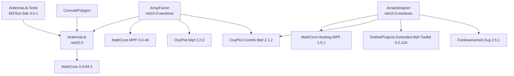
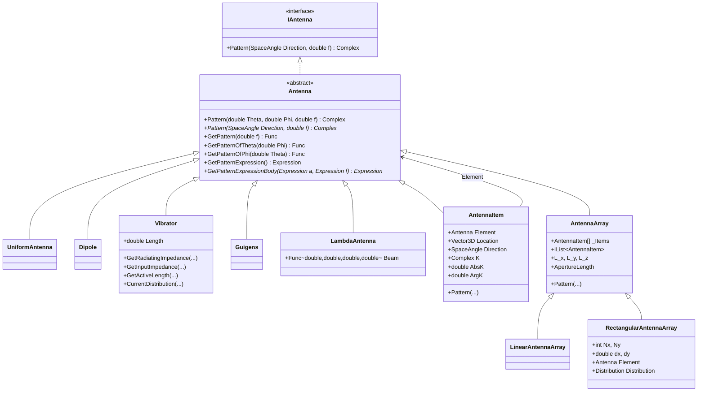
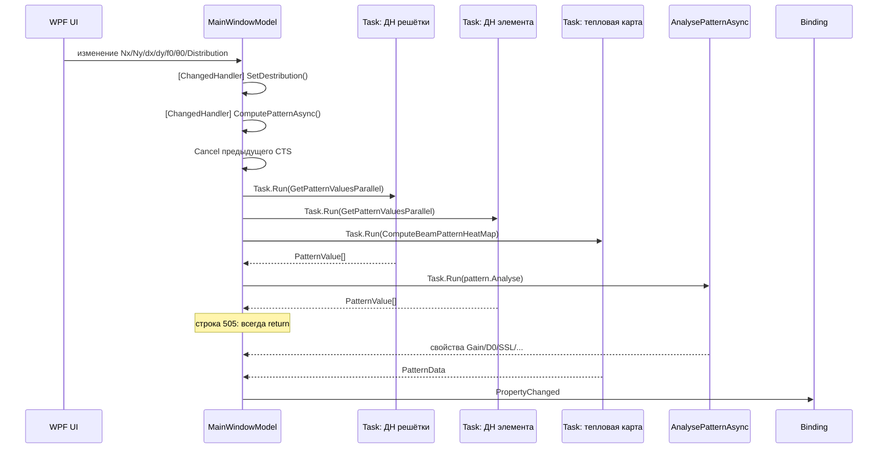
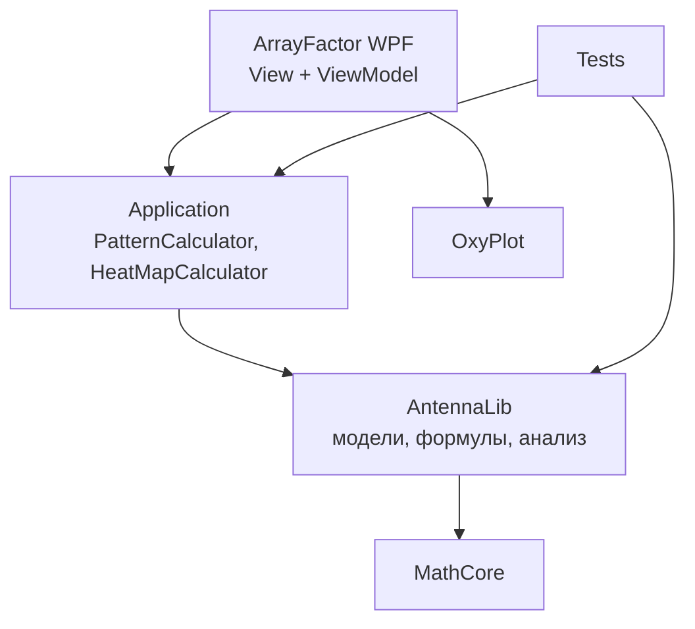
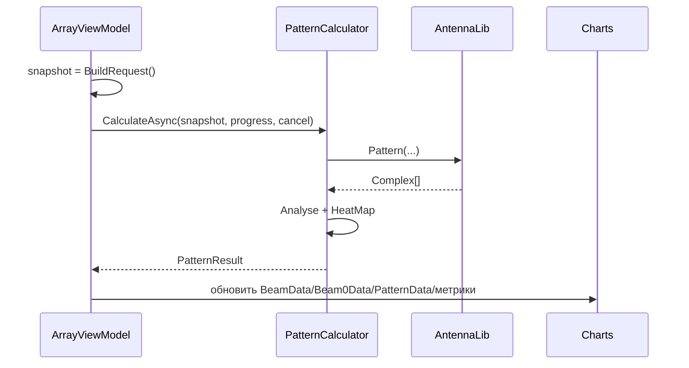

# Технический аудит проекта AntennaLab

> Документ подготовлен для передачи кодовому агенту: содержит карту кода, описание архитектуры,
> инварианты предметной области, реестр подтверждённых дефектов и план рефакторинга.
> Все ссылки на код даны в формате `файл:строка` относительно корня репозитория.

| Параметр | Значение |
|---|---|
| Объект аудита | решение `AntennaLab.slnx` |
| Корень репозитория | `d:\src\dep406\AntennaLab` |
| Ветка / коммит | `dev` / `21ac8ff` (`origin/dev`) |
| Дата аудита | 2026-10-18 |
| Среда сборки | Windows, .NET SDK `10.0.402` |
| Целевые платформы | `net10.0`, `net10.0-windows` |
| Методы | чтение исходников, сборка, запуск тестов, пробные file-based C# приложения, анализ зависимостей |
| Ограничение | WPF-интерфейс не запускался интерактивно; выводы по UI сделаны по XAML и коду, численные проверки — на `AntennaLib` |

---

## Содержание

1. [Краткое резюме](#1-краткое-резюме)
2. [Состав решения](#2-состав-решения)
3. [Архитектура AntennaLib](#3-архитектура-antennalib)
4. [Архитектура ArrayFactor](#4-архитектура-arrayfactor)
5. [ArrayDesigner](#5-arraydesigner)
6. [Тесты и качество](#6-тесты-и-качество)
7. [Реестр дефектов](#7-реестр-дефектов)
8. [План рефакторинга](#8-план-рефакторинга)
9. [Целевая архитектура](#9-целевая-архитектура)
10. [Критерии приёмки](#10-критерии-приёмки)
11. [Приложения](#11-приложения)

---

## 1. Краткое резюме

### 1.1. Состояние на момент аудита

| Проверка | Результат |
|---|---|
| `dotnet build AntennaLab.slnx -c Debug` | успешно, **0 ошибок**, **11 предупреждений** |
| `dotnet test Tests/AntennaLib.Tests/AntennaLib.Tests.csproj` | **65 из 65 тестов пройдено**, 0 падений, ~0,6 с |
| `dotnet list package --vulnerable --include-transitive` | уязвимых пакетов не найдено |
| `Tests/ConsolePolygon` | падает с `InvalidCastException` при старте |
| CI | отсутствует: каталог `.github/workflows` пуст |

### 1.2. Главные выводы

1. **Основной сценарий `ArrayFactor` частично не работает.** В `ArrayFactor/MainWindow.Model.cs:505`
   стоит условие `if (cancel.IsCancellationRequested is true or true) return;` — оно **всегда истинно**.
   Метод выходит до присваивания `BeamData` и `Beam0Data`, поэтому линейные графики ДН остаются пустыми,
   а `Task.WhenAll` для анализа и тепловой карты не ожидается.
2. **Физические единицы в UI несогласованы.** `D0` (КНД) вычисляется как отношение мощностей,
   переводится в дБ через `In_dB()` (20·log10) в `MainWindow.Model.cs:608`, а затем в XAML
   (`MainWindow.xaml:249`) ещё раз пропускается через конвертер `{dB}` (тоже 20·log10).
   Для 16-элементной решётки это даёт ~27,6 дБ вместо ~12,0 дБ. Аналогично `Gain` — это 20·log10
   максимума поля, а не коэффициент усиления по мощности.
3. **Публичный API библиотеки содержит подтверждённые дефекты:** `AntennaItem.ArgK` возвращает модуль,
   `AntennaArray.AddRange` всегда бросает исключение на непустой решётке, `BeamPatternExtensions.Analyze`
   падает с `IndexOutOfRangeException` на типовых ДН, `PatternValue.AngleRad` возвращает угол в «дважды
   радианах», `AntennaArray.CreateFlatArray` не центрирует решётку.
4. **Expression API неработоспособен** для `Guigens`, `Dipole`, `Vibrator` и для решёток:
   подтверждены `InvalidOperationException`, `ArgumentException` и `InvalidCastException`.
   Тест `AntennaTests.GetPatternExpression_ShouldBeCallable` маскирует это, проглатывая `ArgumentException`.
5. **Архитектура `ArrayFactor` имеет гонки и лишние пересчёты:** `async void`, изменяемая `_AntennaArray`
   используется одновременно UI-потоком и фоновыми задачами без снимка состояния, параметры читаются
   внутри `Task.Run`, отмена не освобождает `CancellationTokenSource`, а изменение угла обзора `PhiView`
  может инициировать полный пересчёт физической модели через `SetDestribution`.
6. **Инфраструктура качества отсутствует:** нет CI, `Directory.Build.props`, `Directory.Packages.props`,
   `global.json`, `.editorconfig`, анализаторов, покрытия и тестов на большинство типов ядра.

### 1.3. Общая оценка

| Область | Оценка | Комментарий |
|---|---|---|
| Вычислительное ядро | Средняя | компактное, читаемое, но есть грубые ошибки в краевых случаях и единицах |
| WPF-приложение | Низкая | основной конвейер отображения ДН сломан, архитектура «god-model» |
| Тесты | Низкая | 65 тестов, но много «smoke»-проверок; ключевые типы не покрыты |
| Инфраструктура | Низкая | нет CI, централизованной сборки и статических анализаторов |
| Готовность к рефакторингу | Средняя | код небольшой (≈6 тыс. непустых строк), границы слоёв понятны, но требуется зафиксировать инварианты |

---

## 2. Состав решения

### 2.1. Проекты

| Проект | Тип | TFM | Назначение | Файлов | Непустых строк |
|---|---|---|---|---|---|
| `AntennaLib` | class library | `net10.0` | модели антенн, решёток и расчёт ДН | 17 | 1479 |
| `ArrayFactor` | WPF `WinExe` | `net10.0-windows` | интерактивный расчёт и визуализация ФАР | 33 | 2352 |
| `ArrayDesigner` | WPF `WinExe` | `net10.0-windows` | заготовка UI-дизайнера макета решётки | 12 | 374 |
| `Tests/AntennaLib.Tests` | MSTest | `net10.0` | модульные тесты библиотеки | 9 | 884 |
| `Tests/ConsolePolygon` | console `Exe` | `net10.0` | экспериментальный «полигон», не тестовый проект | 8 | 891 |
| **Итого** | | | | **79** | **≈5980** |

`AntennaLib` имеет `RootNamespace=Antennas`, поэтому все типы библиотеки находятся в пространстве имён
`Antennas`, а не `AntennaLib`.

### 2.2. Граф зависимостей



### 2.3. Пакеты и версии

| Пакет | Версия | Проект | Замечание |
|---|---|---|---|
| `MathCore` | 0.0.94.3 | `AntennaLib`, `ArrayFactor`, `ConsolePolygon` | базовая математика, `Complex`, `SpaceAngle`, `Vector3D`, MVVM-база |
| `MathCore.WPF` | 0.0.49 | `ArrayFactor` | `ViewModel`, `[ChangedHandler]`, `[DependsOn]`, конвертеры `dB`, `Addition`, `Subtraction`, `Multiply`, `Divide` |
| `OxyPlot.Wpf` | 2.2.0 | `ArrayFactor` | графики |
| `OxyPlot.Contrib.Wpf` | 2.1.2 | `ArrayFactor`, `ArrayDesigner` | в `ArrayDesigner` фактически не используется |
| `MathCore.Hosting.WPF` | 1.0.1 | `ArrayDesigner` | DI-хостинг WPF |
| `DotNetProjects.Extended.Wpf.Toolkit` | 5.0.129 | `ArrayDesigner` | в XAML не используется |
| `FontAwesome6.Svg` | 2.5.1 | `ArrayDesigner` | используется в `Styles/Default.xaml` |
| `MSTest.Sdk` | 4.0.1 | `AntennaLib.Tests` | `UseVSTest=true` |
| `Microsoft.NET.Test.Sdk` | 18.0.1 | `AntennaLib.Tests` | |
| `MSTest.TestAdapter` / `TestFramework` | 4.0.2 | `AntennaLib.Tests` | |

Версии пакетов задаются в каждом `.csproj` отдельно; централизованного управления версиями нет.

---

## 3. Архитектура AntennaLib

### 3.1. Иерархия типов



Ключевая особенность: `AntennaItem` **сам является** `Antenna` и одновременно **содержит** `Antenna`.
Это позволяет строить иерархии элементов, но требует аккуратности: `AntennaArray` тоже является `Antenna`
и может быть добавлена сама в себя (частично защищено проверками).

### 3.2. Контракт `IAntenna` / `Antenna`

Центральный контракт:

```csharp
Complex Pattern(SpaceAngle Direction, double f);
```

- `Direction` — направление в дальней зоне; углы в **радианах**.
- `f` — частота в **герцах**.
- Результат — комплексная амплитуда поля в выбранной поляризации/нормировке.

`Antenna` дополнительно предоставляет:
- `Pattern(double Theta, double Phi, double f)` — удобная перегрузка;
- `GetPattern(f)`, `GetPatternOfTheta(...)`, `GetPatternOfPhi(...)` — фабрики функций;
- `GetPatternExpression()` / `GetPatternExpressionBody(...)` — построение LINQ Expression для компиляции ДН.

`Antenna` наследует `MathCore.ViewModels.ViewModel` и реализует `INotifyPropertyChanged`.
Это связывает вычислительное ядро с MVVM-инфраструктурой; для чистого вычислительного слоя это
нежелательная зависимость (см. § 9).

### 3.3. `AntennaItem`

Назначение — элемент решётки с положением, ориентацией и комплексным коэффициентом возбуждения.

Модель:

```text
F_item(a, f) = K · F_element(R(a), f) · exp(-j · k · (r · a)),  k = 2πf / c
```

где:
- `r` — `Location` (метры);
- `a` — единичный вектор направления;
- `R(a)` — поворот направления при ориентации элемента (`Direction`, `_Rotator`);
- `K` — комплексный коэффициент (`AbsK`, `ArgK`, `ReK`, `ImK`).

Свойства:
- `Location`, `LocationX/Y/Z` — положение;
- `Direction`, `Theta`, `ThetaDeg`, `Phi`, `PhiDeg` — ориентация;
- `K`, `AbsK`, `ArgK`, `ReK`, `ImK` — коэффициент;
- `Name` — необязательное имя (в `ToString` не используется).

Замечания:
- `ArgK` **сломан**: getter возвращает `K.Abs` вместо `K.Arg` (`AntennaLib/AntennaItem.cs:85`).
- `Direction` использует точное сравнение `Theta == 0 && Phi == 0` для выбора отсутствия ротатора.
- Подписка на `PropertyChanged` элемента снимается при замене `Element`, но `IDisposable` не реализован.

### 3.4. `AntennaArray`

Назначение — набор `AntennaItem` и расчёт суммарной ДН.

- `Pattern(a, f)` = сумма `AntennaItem.Pattern(a, f)`; для пустого массива возвращает `Complex.NaN`.
- Реализует `IList<AntennaItem>`; мутирующие методы (`Add`, `Insert`, `Remove`, `AddRange`) копируют
  массив целиком.
- `ApertureLength`, `L_x`, `L_y`, `L_z` вычисляются агрегатами по `_Items` при каждом обращении.
- `CreateLinearArray(...)`, `CreateFlatArray(...)` — фабрики.
- `SaveToFile(...)` — экспорт элементов в TSV.
- `GetPatternExpressionBody(...)` — сумма выражений элементов.

Проблемы:
- `AddRange` копирует `new_items.Length` элементов вместо `to_add.Length`
  (`AntennaLib/AntennaArray.cs:229`) — подтверждённое исключение на непустом массиве.
- `CreateFlatArray` не центрирует решётку: `lx05 = dx * (nx - 1)` вместо `dx * (nx - 1) / 2`
  (`AntennaLib/AntennaArray.cs:48`).
- `Pattern` использует `_Items.AsParallel().Sum(...)` (`AntennaLib/AntennaArray.cs:109`); при вызове
  из PLINQ-цикла по углам возникает вложенный параллелизм.
- `Add(null)` и `this[index] = null` не запрещены; последующий `Pattern` упадёт с `NullReferenceException`.
- `GetPatternExpressionBody` использует `Aggregate` без начального значения
  (`AntennaLib/AntennaArray.cs:240-243`): пустая решётка бросает `InvalidOperationException`,
  а `null`-выражение элемента может привести к `Expression.Add(x, null)`.
- `IList`-мутаторы не поддерживают инвариант «`Count == Nx*Ny`» для `RectangularAntennaArray`.

### 3.5. `LinearAntennaArray` и `RectangularAntennaArray`

`LinearAntennaArray`:
- размещает элементы вдоль оси X с шагом `d`;
- центрирует по `L_x / 2` в конструкторе;
- наследует мутаторы `AntennaArray`, поэтому добавление/удаление элементов после конструктора
  нарушает центрирование.

`RectangularAntennaArray`:
- хранит `Nx`, `Ny`, `dx`, `dy`, `Element`, `Distribution`;
- `Nx`/`Ny` при изменении вызывают `RefreshConstruction()` (`Clear()` + `AddRange(Initialize(...))`);
- `dx`/`dy` вызывают `RefreshGeometry()`, пересчитывающий координаты и `K`;
- `Element` и `Distribution` применяются ко всем элементам;
- не поднимает `PropertyChanged` для своих свойств (в `MainWindowModel` уведомления делаются вручную);
- `RefreshGeometry` предполагает `Count == Nx*Ny`; после ручных мутаций через `IList` индексация ломается.

### 3.6. Элементарные излучатели

| Тип | `Pattern` | Особенности |
|---|---|---|
| `UniformAntenna` | `1` | всенаправленный, `sealed` |
| `Dipole` | `cos(θ)` | не зависит от частоты и φ; физически это не классический диполь (у диполя `sin θ`) |
| `Vibrator` | `(cos(kL·cosθ) − cos(kL)) / sinθ` | `k = 2πf/c`; при `θ = 0` возвращает `0`; есть статические методы импеданса/тока |
| `Guigens` | `cos²(θ)` | в XML-комментарии заявлен `cos²(θ)`, в expression — `cos²(θ/2)` |
| `LambdaAntenna` | `Beam(θ, φ, f)` | пользовательская функция |

`Vibrator` дополнительно содержит:
- `GetRadiatingImpedance(Length, f0)`;
- `GetInputImpedance(Length, rho, f0)`;
- `GetActiveLength(f)`;
- `CurrentDistribution(f0, Length, z)`;
- `GetWaveImpedance(d, D)`.

Формулы `GetInputImpedance` и `GetActiveLength` выглядят эмпирическими/размерно неоднородными;
перед использованием в инженерных расчётах требуется отдельная валидация.

### 3.7. Расчёт ДН: единицы и допущения

- Углы в библиотеке — радианы.
- Частота — герцы.
- Координаты — метры.
- `SpaceAngle(θ, φ)`: `θ` — зенитный угол от оси Z, `φ` — азимут от оси X.
- `new SpaceAngle()` — нулевое направление (θ = 0, φ = 0).
- Расчёт — приближение дальней зоны, без взаимного влияния элементов и без учёта поляризации.
- `AntennaArray.Pattern` для пустого массива возвращает `Complex.NaN` — это осознанное поведение,
  но его нужно документировать и проверять в тестах.

### 3.8. Анализ ДН: два независимых API

В библиотеке есть **два** похожих, но разных API анализа:

| API | Файл | Состояние | Где используется |
|---|---|---|---|
| `BeamPatternExtensions.Analyze(this Func<double, Complex>)` | `AntennaLib/BeamPatternExtensions.cs` | **падает на типовых ДН** | `ConsolePolygon`, README |
| `PatternValueExtensions.Analyse(this PatternValue[])` | `AntennaLib/Extentions/PatternValueExtentions.cs` | работает, используется приложением | `ArrayFactor` |

`PatternValueExtensions.Analyse` возвращает `AnalysePatternResult` с:
- `Max`, `MaxIndex`, `MaxAngle`;
- `D0` — КНД (отношение мощностей);
- `Th07Left/Right`, `Th0Left/Right`;
- `LeftSsl`, `RightSLL`, `SSL`, `LeftMeanSLL`, `RightMeanSLL`, `MeanSLL`.

`BeamPatternExtensions.Analyze` возвращает `BeamAnalysandResult` с:
- `MaximumIndex`, `AngleOfMaximum`, `ValueOfMaxMaximum`;
- `BeamWidth`, `BeamCenterAngle`, `Simetry`;
- `LeftSideLobe`, `RightSideLobe`, `LeftAverageSideLobLevel`, `RightAverageSideLobLevel`;
- `Directivity`, `Accuracy`.

Рекомендация: оставить один API (или явно разделить «анализ массива отсчётов» и «адаптивный анализ
функции»), привести имена к единому стилю (`Analyze` / `Analyse` — выбрать один вариант).

### 3.9. Expression API

Идея: построить `Expression<Func<SpaceAngle, double, Complex>>` и скомпилировать его для быстрого
многократного расчёта ДН без виртуальных вызовов.

Фактическое состояние — **неработоспособно**:

| Тип | Ошибка | Подтверждение |
|---|---|---|
| `Guigens` | `InvalidOperationException: The binary operator Divide is not defined for the types 'System.Double' and 'System.Int32'` | `AntennaLib/Guigens.cs:20` |
| `Dipole` | `ArgumentException: Expression of type 'System.Double' cannot be used for return type 'MathCore.Complex'` | `AntennaLib/Dipole.cs:15` |
| `Vibrator` | `ArgumentException: Instance field 'length' is not defined for type 'Antennas.Vibrator'` | `AntennaLib/Vibrator.cs:85` |
| `AntennaArray` (через `AntennaItem`) | `InvalidCastException: Unable to cast ConstantExpression to BinaryExpression` | `AntennaLib/AntennaItem.cs:139` |

Причины:
- `Guigens`: `Divide(2.ToExpression())` создаёт `int`-константу, а `Expression.Divide` не умеет делить
  `double` на `int` без приведения.
- `Dipole`: `MathExpression.Cos(...)` возвращает `double`, а сигнатура требует `Complex`.
- `Vibrator`: primary constructor parameter `length` не является полем с именем `length`
  (компилятор создаёт поле с непроизносимым именем), поэтому `GetField("length")` не находит его.
- `AntennaItem`: `Multiply` из `MathCore.Extensions.Expressions` ожидает `BinaryExpression`,
  а получает `ConstantExpression`.

Рекомендация: либо исправить и покрыть тестами каждый излучатель и решётку, либо удалить Expression API
из публичного контракта (сейчас он только вводит в заблуждение и не используется приложением).

### 3.10. `PatternManager`

`AntennaLib/PatternManager.cs` — **заготовка**:
- хранит `_Antenna`, `_f0`, `_Th1`, `_Th2`, `_dth0`, `_Phi`, `_Values`;
- конструктор валидирует `eps_db` и `f0`;
- **не содержит методов расчёта** и нигде не используется.

Рекомендация: удалить или реализовать как часть нового вычислительного сервиса.

---

## 4. Архитектура ArrayFactor

### 4.1. MVVM-инфраструктура

`ArrayFactor` использует `MathCore.WPF`:
- `ViewModel` — база с `Set`, `Get`, `OnPropertyChanged`;
- атрибуты `[ChangedHandler(nameof(...))]`, `[DependsOn(nameof(...))]`, `[AffectsThe(nameof(...))]` —
  декларативная подписка на изменения свойств;
- `Command`, `MarkupExtension` и конвертеры `dB`, `Addition`, `Subtraction`, `Multiply`, `Divide`.

`MainWindowModel` создаётся как `DataContext` прямо в XAML:

```xml
<l:MainWindowModel Nx="8" Ny="8" dx="10" dy="10"/>
```

Это означает, что каждый setter начальных значений запускает соответствующие `[ChangedHandler]`-методы
ещё до полной инициализации окна.

### 4.2. `MainWindowModel` — «god-model»

Файл `ArrayFactor/MainWindow.Model.cs` (~650 строк) совмещает:
- параметры решётки (`Nx`, `Ny`, `dx`, `dy`, `ElementaryAntenna`, `Distribution`);
- параметры облучения (`f0`, `λ0`, `θ0`, `φ0`, `PhiView`, `dθ`);
- физическую модель (`RectangularAntennaArray _AntennaArray`);
- расчёт сечений ДН и ДН элемента;
- расчёт тепловой карты;
- анализ ДН и производные метрики (`Gain`, `D0`, `SSL`, `MeanSSL`, `BeamWidth07/0`, `BeamPos`);
- прогресс вычислений (`PatternComplete`, `PatternData`).

Основные свойства и связи:

| Свойство | Единицы UI | Единицы модели | Триггер |
|---|---|---|---|
| `Nx`, `Ny` | шт. | шт. | `SetDestribution`, пересчёт |
| `dx`, `dy` | см | м (`/100`) | `SetDestribution`, пересчёт |
| `f0` | ГГц | Гц (`×1e9`) | `SetDestribution`, пересчёт |
| `λ0` | см | — | `SetDestribution`, пересчёт |
| `θ0` | градусы | радианы (`×ToRad`) | `SetDestribution` |
| `φ0` | градусы | радианы | **никогда не задаётся** |
| `PhiView` | градусы | радианы | `SetDestribution` (лишний пересчёт) |
| `dθ` | градусы | радианы | пересчёт |
| `Gain`, `D0`, `SSL`, `MeanSSL` | дБ | — | результат анализа |
| `BeamWidth07/0`, `BeamPos` | градусы | — | результат анализа |

Единицы:
- `f0` в UI — ГГц; в библиотеку передаётся `_f0 * c_GHz`.
- `λ0` в UI — см; связь `λ0 = 30 / f0` (при `f0` в ГГц).
- `dx`/`dy` в UI — см; в модели — метры.
- `θ0`, `φ0`, `PhiView`, `dθ` в UI — градусы; в библиотеку — радианы.
- `θ2_07_x` = `51 * λ0 / L_x / 100` — корректно приводит см и м.
- `θmax_x` = `Abs(Asin(λ0 / dx / 100 - 1)).ToDeg()` — **размерная ошибка** (см. § 7).

### 4.3. Асинхронный конвейер



Фактическое поведение после строки 505:
- `BeamData` и `Beam0Data` **не присваиваются** → линейные графики пусты;
- `analyse_pattern_task` и `beam_heatmap_task` не ожидаются через `Task.WhenAll`;
- `AnalysePatternAsync` всё же выполняется и обновляет числовые метрики;
- `ComputeBeamPatternHeatMapAsync` всё же выполняет работу и присваивает `PatternData`,
  поэтому тепловая карта может отображаться.

Дополнительные проблемы конвейера:
- `ComputePatternAsync` — `async void` (`MainWindow.Model.cs:486`): исключения, кроме
  `TaskCanceledException`/`OperationCanceledException`, не перехватываются и могут уронить приложение.
- `_ComputePatternCancellationTokenSource` не освобождается (`Dispose` не вызывается).
- `GetBeamDataAsync`/`GetBeam0DataAsync` читают `_f0`, `_PhiView`, `_dθ` **внутри** `Task.Run`
  (`MainWindow.Model.cs:472`, `482`), а не снимают значения до запуска.
- `_AntennaArray` — изменяемый объект, который UI-поток меняет через `Nx`/`dx`/`Distribution`,
  пока фоновые задачи его читают; снимка состояния нет.
- `AnalysePatternAsync` может завершиться позже более нового расчёта и перезаписать метрики старыми
  значениями.
- `ComputeBeamPatternHeatMapAsync` может присвоить `PatternData = null` после того, как более новый
  расчёт уже установил данные.

### 4.4. Амплитудные распределения

`ArrayFactor/Service/AmplitudeDistributions`:

| Класс | Формула | Замечание |
|---|---|---|
| `Uniform` | `1` | эталон |
| `CosOnDelta` | `D + (1−D)·cosⁿ(πx)` по каждой оси | `D` — пьедестал, `n` — степень |
| `Chebishew` | `1 − (1−D)·4x²` | это **параболическое**, а не чебышевское распределение; имя вводит в заблуждение |
| `Triangle` | `1 − abs(2x)` | параметр `Dx`/`Dy` **игнорируется** (`Triangle.cs:12`) |
| `Lambda` | делегат | используется программно |
| `UserDistribution` | парсер `MathCore.MathParser` | не включён в UI; ошибки парсера в `CreateExpression` не перехватываются |

`Distribution` — базовый `ViewModel` с `Value(x, y, z)`, `GetDistribution(...)`, `DistributionValue`.
`GetDistribution` в `MainWindowModel` не используется: там своя ленивая `DistributionData` на
`ParallelQuery<double>`.

### 4.5. Тепловая карта

`ComputeBeamPatternHeatMap` (`MainWindow.Model.cs:392-445`):
- сетка `N = 2 * (90 / 0.5) = 360` по каждой оси;
- для каждой точки `(i, j)` вычисляется `Complex(N/2 - i, j - N/2)`, по нему `th = |z| * dth`,
  `phi = arg(z)`;
- точки с `th > 90` заполняются `NaN`;
- значения нормируются к максимуму и ограничиваются снизу `−80 дБ`;
- результат — `double[,]`, привязанный к `HeatMapSeries` с `X0=-90, X1=90, Y0=-90, Y1=90`.

Замечания:
- `Complex` используется как 2D-вектор — работает, но неочевидно.
- Нормализация содержит мёртвую логику `value is double.NaN` (`MainWindow.Model.cs:431`, `434`):
  в C# сравнение с `double.NaN` через `is` всегда ложно; нужно `double.IsNaN(value)`.
- Магические константы `90`, `0.5`, `−80` не вынесены в конфигурацию.
- Отображение полярной сетки на линейные `X0..Y1` требует проверки: координаты heatmap не равны
  угловым координатам напрямую.

### 4.6. XAML-слой и конвертеры

`MainWindow.xaml` (~874 строки):
- три вкладки: декартово сечение, полярное сечение, тепловая карта;
- `LineSeries` для `BeamData` и `Beam0Data` (`DataFieldX="AngleDeg"`, `DataFieldY="ValueIndB"`);
- аннотации `Gain`, `SSL`, `MeanSSL`, границы луча;
- `HeatMapSeries Data="{Binding PatternData}"`;
- `ComboBox` для элемента и распределения;
- множество `ScrollBar`/`TextBox` с `FallbackValue`.

Конвертеры:
- `{dB}` — из `MathCore.WPF`, по умолчанию 20·log10 (есть `ByPower` для 10·log10);
- `{Addition}`, `{Subtraction}`, `{Multiply}`, `{Divide}` — из `MathCore.WPF`;
- локальные `ArrayFactor/Service/Converters/{Add, Substract, Multiply, Divide}.cs` — дубликаты,
  используются только в мёртвом `SmithChart`;
- `AngleArcProgressBarConverter` — **баг**: все три значения читаются из `vv[0]`
  (`ArrayFactor/Service/Shapes/AngleArcProgressBarConverter.cs:16-18`);
- `DoubleToStringConverter` — опечатка `Pressigion`, `Convert` использует `InvariantCulture`,
  `ConvertBack` — текущую культуру.

### 4.7. Мёртвый код и неиспользуемые ресурсы

| Объект | Состояние |
|---|---|
| `PatternManager` | заготовка, не используется |
| `BeamPatternExtensions` | не используется приложением; падает на типовых ДН |
| `WaveInfo` | не используется |
| `ProgressInfo` | не используется |
| `Service/Extensions.cs` (`GetService`, `UseService`) | не используется |
| `Service/Controls/SmithChart.xaml` + converters | не используется |
| `Service/TestWindow.xaml` | не используется |
| `Service/ControlStyles.xaml` | не используется |
| `Service/Shapes/AngleArcProgressBarConverter` | не используется, содержит баг |
| локальные `Add`/`Substract` | используются только в мёртвом `SmithChart` |
| `ComputeD0Async` | не вызывается (закомментирован вызов) |
| `D0_Total` | вычисляется только в мёртвом `ComputeD0Async` |
| `_dx` (0.01) | используется только для `GetXRange`/`DistributionData` |
| `c_Pi`, `c_Pi05` | не используются |
| `PatternComplite` в XAML | только в закомментированных блоках |
| `Antenna.xml` | пример формата, кодом не читается |
| `.github/upgrades/*` | устаревший отчёт миграции на net9.0 |

---

## 5. ArrayDesigner

`ArrayDesigner` — отдельный WPF-проект, не ссылающийся на `AntennaLib`.

Состояние:
- `App.xaml` использует `ApplicationHosting` и `ServiceLocator` из `MathCore.Hosting.WPF`;
- `MainWindowViewModel` помечен `[Service]`, создаёт `LayoutDesignerViewModel` и один
  `ArrayItemViewModel` в точке `(50, 50)`;
- вычисленные `nx`, `ny`, `dx`, `dy` не используются (закомментированы);
- `MainWindow.xaml` содержит жёстко заданные `TextBox` для `Lx`, `Ly`, «Число элементов»,
  не связанные с моделью;
- `LayoutDesignersStyles.xaml` рисует один элемент на `Canvas`;
- `OxyPlot.Contrib.Wpf` и `DotNetProjects.Extended.Wpf.Toolkit` подключены, но не используются;
- сборка даёт `CS8602` в `MainWindowViewModel.cs:15`.

Вывод: это **прототип/заготовка**, а не рабочий дизайнер. Нужно либо явно обозначить статус в README,
либо интегрировать с `AntennaLib` и реализовать привязку геометрии.

---

## 6. Тесты и качество

### 6.1. `AntennaLib.Tests`

- MSTest 4.0.2, `MSTest.Sdk/4.0.1`, `UseVSTest=true`.
- `MSTestSettings.cs`: `[assembly: Parallelize(Scope = ExecutionScope.MethodLevel)]`.
- 65 тестов в 8 классах:
  - `AntennaTests` (6);
  - `AntennaItemTests` (11);
  - `DipoleTests` (6);
  - `IAntennaInterfaceTests` (3);
  - `LambdaAntennaTests` (7);
  - `LinearAntennaArrayTests` (9);
  - `UniformAntennaTests` (5);
  - `VibratorTests` (11).

Сильные стороны:
- тесты быстрые, детерминированные, с осмысленными именами;
- проверяются базовые контракты и значения в характерных точках;
- есть `DataRow` для углов и частот.

Слабые стороны:
- много проверок «не NaN»/«не ноль» вместо числовых эталонов:
  `GetActiveLength_ShouldReturnValue`, `CurrentDistribution_ShouldReturnValues`,
  `GetInputImpedance_ShouldReturnNonZeroValue`, `Pattern_ShouldShowArrayEffect`;
- `CoefficientModulusAndPhase_CanBeModified` не проверяет `ArgK` — именно поэтому баг `ArgK` не пойман;
- `GetPatternExpression_ShouldBeCallable` перехватывает `ArgumentException` и игнорирует его —
  это скрывает неработающий Expression API;
- `Array_ShouldBeMoreDirective` вычисляет `single_pattern_off`/`array_pattern_off`, но не использует их;
- нет тестов на `AntennaArray` (базовый), `RectangularAntennaArray`, `Guigens`,
  `BeamPatternExtensions`, `PatternValueExtensions`, `AntennaExtensions`, `PatternManager`,
  `PatternValue`, `PatternCalculationTaskProgressInfo`;
- нет тестов на `ArrayFactor` (модель, распределения, конвейер);
- нет измерения покрытия и мутационного тестирования.

### 6.2. `Tests/ConsolePolygon`

Это **не тестовый проект**, а консольный полигон:
- `Program.Main` вызывает `BeamPatternExpression.Test()` и `BeamPatternAnalisysTest.Test()`;
- `BeamPatternExpression.Test()` падает с `InvalidCastException` (Expression API);
- `FDTD`, `ParticleSwarmTest`, `ObjectModel`, `AdaptiveSamplingTest` — эксперименты,
  большинство не вызывается;
- в `ParticleSwarmTest` 6 предупреждений `CS8602`;
- `BeamPatternAnalisysTest` содержит неиспользуемую переменную `k` (`CS0219`).

Рекомендация: вынести эксперименты в отдельный репозиторий/папку `sandbox`, не включать в решение
как «тесты», либо преобразовать полезные сценарии в модульные тесты.

### 6.3. Инфраструктура качества

Отсутствует:
- `.github/workflows` — CI не настроен;
- `Directory.Build.props` — общие свойства дублируются;
- `Directory.Packages.props` — версии пакетов не централизованы;
- `global.json` — версия SDK не зафиксирована;
- `.editorconfig` — стиль не enforced;
- `<AnalysisLevel>`, `<TreatWarningsAsErrors>`, анализаторы — не включены;
- `GenerateDocumentationFile` — XML-документация не генерируется;
- покрытие кода и порог покрытия — не настроены.

---

## 7. Реестр дефектов

Приоритеты:
- **P0** — блокирует основной сценарий или даёт физически неверный результат;
- **P1** — серьёзный дефект, есть обходной путь;
- **P2** — качество/поддерживаемость, скрытые ошибки;
- **P3** — косметика, мёртвый код, нейминг.

### 7.1. P0 — критические

#### D-01. `ComputePatternAsync` всегда завершается досрочно

- **Где:** `ArrayFactor/MainWindow.Model.cs:505`.
- **Код:** `if (cancel.IsCancellationRequested is true or true) return;`
- **Симптом:** после `await beam0_task` метод всегда выходит. `BeamData`/`Beam0Data` не присваиваются,
  линейные графики ДН пусты; `Task.WhenAll` не ожидает анализ и тепловую карту.
- **Подтверждение:** статический анализ; условие `is true or true` тождественно истинно.
- **Исправление:** заменить на `if (cancel.IsCancellationRequested) return;`, добавить тест/смоук,
  проверяющий, что после расчёта `BeamData` и `Beam0Data` не `null` и непусты.

#### D-02. Неверные единицы КНД/усиления и двойное преобразование в дБ

- **Где:**
  - `AntennaLib/Extentions/PatternValueExtentions.cs:110` — `D0 = max*max*2/integral` (отношение мощностей);
  - `ArrayFactor/MainWindow.Model.cs:608` — `D0 = result.D0.In_dB();` (20·log10);
  - `ArrayFactor/MainWindow.xaml:249` — `Converter={dB}` (ещё раз 20·log10);
  - `ArrayFactor/MainWindow.Model.cs:606` — `Gain = result.Max.In_dB();` (20·log10 поля);
  - `AntennaLib/Extentions/PatternValue.cs:25` — `ValueIndBP => Value.Abs.In_dB_byPower()` (10·log10 поля).
- **Симптом:** для 16-элементной решётки `D0` (линейный) = 16. `In_dB()` даёт 24,08 дБ,
  конвертер `{dB}` в XAML даёт ~27,6 дБ, тогда как корректный КНД = `10·log10(16)` = 12,04 дБ.
  `Gain` показывает 24,08 дБ как «КУ», хотя усиление по мощности = 12,04 дБ.
- **Подтверждение:** `In_dB(16)=24,082`, `In_dB_byPower(16)=12,041`; `Analyse` для 16-элементной
  решётки возвращает `D0=16`.
- **Исправление:** определить единую политику:
  - поле/амплитуда — 20·log10 (`In_dB`);
  - мощность/КНД/усиление — 10·log10 (`In_dB_byPower`);
  - `D0` хранить в дБ через `In_dB_byPower()`, убрать `Converter={dB}` из XAML;
  - `Gain` переименовать в `MaxField_dB` либо вычислять как усиление по мощности;
  - `ValueIndBP` исправить на `Value.Power.In_dB_byPower()` (или `Value.Abs.In_dB()`).

#### D-03. `_φ0` никогда не задаётся

- **Где:** `ArrayFactor/MainWindow.Model.cs:57`, `:632`.
- **Симптом:** `φ0` всегда 0; сканирование по азимуту недоступно, хотя `GetPhaseDistribution`
  принимает `Phi`. Предупреждение `CS0649`.
- **Исправление:** добавить публичное свойство `φ0` с `[ChangedHandler(nameof(SetDestribution))]`
  и привязку в XAML, либо удалить поле и параметр, если сканирование по φ не планируется.

### 7.2. P1 — серьёзные

#### D-04. `AntennaArray.AddRange` всегда бросает исключение на непустом массиве

- **Где:** `AntennaLib/AntennaArray.cs:229`.
- **Код:** `Array.Copy(to_add, 0, new_items, _Items.Length, new_items.Length);`
- **Симптом:** `ArgumentException: Source array was not long enough`.
- **Подтверждение:** пробный вызов на `AntennaArray` с одним элементом + `AddRange` из одного элемента.
- **Исправление:** `Array.Copy(to_add, 0, new_items, _Items.Length, to_add.Length);`.
- **Дополнительно:** добавить тесты на `AddRange` для пустого и непустого массива, на `Add(null)`,
  `Insert(null)`.

#### D-05. `BeamPatternExtensions.Analyze` падает на типовых ДН

- **Где:** `AntennaLib/BeamPatternExtensions.cs:105`, `:120`, `:114`, `:129`, `:136`, `:147`.
- **Причины:**
  - `while (ff[index].Argument > ... && index >= 0)` — обращение к `ff[index]` до проверки границы;
  - аналогично справа;
  - деление на `index` и `length - index` без проверки нуля;
  - `GetDirectivity(ff, max_pos)` передаёт **индекс** максимума, а внутри используется как **угол**:
    `Math.Cos(ff[i].Argument - max_pos)`.
- **Симптом:** `IndexOutOfRangeException` для 16-элементной линейной решётки (максимум в центре)
  и для ДН с максимумом на краю диапазона.
- **Подтверждение:** пробные вызовы `Analyze` на `LinearAntennaArray(16, λ/2)` и на `cos(8t)`.
- **Исправление:** переписать обход границ с проверкой индекса перед доступом, передавать
  `ff[max_pos].Argument`, защитить деления, добавить тесты на:
  максимум в начале/конце/центре, узкую ДН, постоянную ДН, одну точку.

#### D-06. Expression API не работает

- **Где:** `AntennaLib/Guigens.cs:20`, `AntennaLib/Dipole.cs:15`, `AntennaLib/Vibrator.cs:85`,
  `AntennaLib/AntennaItem.cs:139`, `AntennaLib/AntennaArray.cs:240-243`.
- **Симптом:** `GetPatternExpression()` бросает исключения для большинства типов; `ConsolePolygon`
  падает на старте.
- **Подтверждение:** четыре разных исключения (см. § 3.9).
- **Исправление:** либо привести типы выражений к `Complex` и исправить `GetField`, либо удалить API.
  Если оставлять — добавить тест `Expression.Compile()` для каждого излучателя и для решётки,
  сравнить результат с `Pattern` в наборе углов.

#### D-07. `AntennaItem.ArgK` возвращает модуль

- **Где:** `AntennaLib/AntennaItem.cs:85`.
- **Код:** `public double ArgK { get => K.Abs; set => K = Complex.Exp(AbsK, value); }`
- **Симптом:** `ArgK` возвращает `|K|`, а не аргумент.
- **Подтверждение:** `K = 1 + i` → `AbsK = 1.4142`, `ArgK = 1.4142` вместо `0.7854`.
- **Исправление:** `get => K.Arg;`.
- **Дополнительно:** усилить тест `CoefficientModulusAndPhase_CanBeModified`, проверяя `ArgK`.

#### D-08. Размерная ошибка в `θmax_x` / `θmax_y`

- **Где:** `ArrayFactor/MainWindow.Model.cs:332`, `:336`.
- **Код:** `Abs(Asin(_λ0 / dx / 100 - 1)).ToDeg()`.
- **Симптом:** для `λ0 = 30 см`, `dx = 10 см` (d = λ/3) формула даёт ~75,9°, хотя при `d < λ/2`
  grating lobes не возникают и сектор должен быть 90°. Для `dx = 15 см` (d = λ/2) — 78,5° вместо 90°.
  Для `dx = 20 см` — 80° вместо 30°.
- **Причина:** `λ0` и `dx` уже в сантиметрах; деление на 100 лишнее; кроме того, формула
  `asin(λ/d − 1)` применима только при `1 ≤ λ/d ≤ 2`, иначе нужна отдельная ветка.
- **Исправление:** вычислять `q = λ0 / dx` (без `/100`), затем:
  - `q >= 2` → 90°;
  - `1 <= q < 2` → `asin(q - 1)`;
  - `q < 1` → grating lobe в visible region (0° или предупреждение).
  Добавить тесты на граничные значения.

#### D-09. `GetPatternValuesParallel` может зависнуть при `dth = 0`

- **Где:** `AntennaLib/Extentions/AntennaExtentions.cs:54-67`, `GetAngles` в том же файле.
- **Симптом:** `GetAngles` с `dth = 0` не увеличивает `th` и генерирует бесконечную последовательность;
  `GetPatternPhi` с `dth = 0` делит на ноль при вычислении длины массива.
- **Исправление:** валидировать `dth > 0` и `th1 != th2` в начале обоих методов; для `GetPatternPhi`
  использовать `Math.Ceiling` и точное число точек, чтобы конечный угол достигался.

#### D-10. `GetPatternPhi` не достигает `th2` при неделящемся шаге

- **Где:** `AntennaLib/Extentions/AntennaExtentions.cs:39`.
- **Код:** `new PatternValue[(int)((Max - Min) / dth) + 1]`.
- **Симптом:** для `th1=-1`, `th2=1`, `dth=0.3` массив содержит 7 точек и заканчивается на `0.8`,
  а не на `1`.
- **Исправление:** `count = (int)Math.Ceiling((max - min) / dth) + 1`, а последнюю точку
  принудительно ставить в `th2`; либо использовать `GetAngles`, который уже гарантирует `th2`.
- **Дополнительно:** привести поведение последовательного и параллельного API к единому.

#### D-11. Гонки и отсутствие снимка состояния в `ArrayFactor`

- **Где:** `ArrayFactor/MainWindow.Model.cs:486-516`, `:472`, `:482`, `:390`.
- **Симптомы:**
  - UI-поток меняет `_AntennaArray`, пока фоновые задачи читают её;
  - `_f0`, `_PhiView`, `_dθ` читаются внутри `Task.Run`;
  - старый расчёт может перезаписать результаты нового;
  - `CancellationTokenSource` не освобождается;
  - `async void` не даёт наблюдать исключения.
- **Исправление:** выделить чистый `PatternCalculator` с неизменяемым входным снимком
  (`record PatternRequest`), вычислять результат в `Task.Run`, возвращать `PatternResult`,
  присваивать свойства только для актуального `requestId`/`CancellationToken`, использовать
  `try/catch` и `Dispose` CTS.

### 7.3. P2 — средние

| ID | Где | Проблема | Исправление |
|---|---|---|---|
| D-12 | `AntennaLib/Extentions/PatternValue.cs:19` | `AngleRad => Angle * Consts.ToRad`; угол уже в радианах → 0,0274 вместо 1,5708 | `AngleRad => Angle` или удалить свойство |
| D-13 | `AntennaLib/AntennaArray.cs:48-49` | `CreateFlatArray` не центрирует: `lx05 = dx*(nx-1)` | делить на 2; добавить тест симметрии |
| D-14 | `ArrayFactor/Service/AmplitudeDistributions/Triangle.cs:12` | параметр `Dx`/`Dy` игнорируется | использовать `D` в формуле или убрать параметры из UI |
| D-15 | `ArrayFactor/Service/AmplitudeDistributions/Chebishew.cs` | формула параболическая, не чебышевская | переименовать в `Parabolic` или реализовать полиномы Чебышева |
| D-16 | `ArrayFactor/MainWindow.Model.cs:431,434` | `value is double.NaN` всегда ложно | `double.IsNaN(value)` |
| D-17 | `ArrayFactor/MainWindow.Model.cs:605` | `MaxPos = result.MaxIndex` — индекс вместо угла | `MaxPos = result.MaxAngle.ToDeg()` или удалить свойство |
| D-18 | `ArrayFactor/MainWindow.Model.cs:486` | `async void` + отсутствие обработки исключений | `async Task` + явный обработчик/логирование |
| D-19 | `AntennaLib/AntennaArray.cs:109` | вложенный PLINQ: `AsParallel().Sum` внутри параллельного цикла по углам | последовательная сумма для малых N; при необходимости — один уровень параллелизма |
| D-20 | `AntennaLib/AntennaArray.cs:240-243` | `Aggregate` без seed, `null`-выражения | `Aggregate(seed, ...)` + проверка `null` |
| D-21 | `AntennaLib/BeamPatternExtensions.cs:147` | `max_pos` — индекс, используется как угол | передавать `ff[max_pos].Argument` |
| D-22 | `AntennaLib/BeamPatternExtensions.cs:114,129` | деление на `index`/`length-index` без проверки | защитить нулём/`NaN` |
| D-23 | `AntennaLib/Extentions/AntennaExtentions.cs:100` | прогресс никогда не достигает 1 | `(i + 1) / (double)len` |
| D-25 | `ArrayFactor/MainWindow.Model.cs:632` | `PhiView` вызывает `SetDestribution` (повторное применение распределения); при срабатывании `[ChangedHandler]` на `DistributionData` это может запускать полный пересчёт | отделить «вид» от «модели»: пересчитывать только `DistributionData` |
| D-26 | `ArrayFactor/MainWindow.Model.cs:390-445` | тепловая карта: магические константы, `Complex` как 2D-вектор, возможные NaN | вынести параметры, использовать `double.IsNaN`, покрыть тестами |
| D-27 | `AntennaLib/AntennaItem.cs` | `Name` инициализируется `null!`, не используется в `ToString` | инициализировать пустой строкой или удалить |
| D-28 | `AntennaLib/AntennaArray.cs` | `IList`-мутаторы ломают инварианты `RectangularAntennaArray` | сделать коллекцию неизменяемой или валидировать `Count == Nx*Ny` |
| D-29 | `ArrayFactor/Service/AmplitudeDistributions/UserDestribution.cs` | ошибки парсера в `CreateExpression` не перехвачены; подписки на переменные не снимаются | `try/catch`, `IDisposable`, отписка |
| D-30 | `ArrayFactor/Service/Shapes/AngleArcProgressBarConverter.cs:16-18` | все значения читаются из `vv[0]` | `vv[0]`, `vv[1]`, `vv[2]` |
| D-31 | `ArrayFactor/Service/DoubleToStringConverter.cs` | `Convert` — InvariantCulture, `ConvertBack` — текущая культура | использовать одну культуру |
| D-32 | `ArrayFactor/Service/Controls/SmithChart.xaml` | `RelativeSource AncestorType=EllipseGeometry` для `Geometry` некорректен; контрол не используется | удалить контрол или переписать привязки |
| D-33 | `ArrayDesigner/ViewModels/MainWindowViewModel.cs:15` | `CS8602`, заготовка без привязки к `AntennaLib` | реализовать или вынести из решения |
| D-34 | `Tests/ConsolePolygon/Program.cs:28` | падение на `BeamPatternExpression.Test()` | исправить Expression API или убрать вызов |
| D-35 | `Tests/ConsolePolygon/BeamPatternAnalisysTest.cs:12` | неиспользуемая `k` (`CS0219`) | удалить |
| D-36 | `Tests/ConsolePolygon/ParticleSwarmTest.cs:96,167,251,299,379,440` | 6×`CS8602` | исправить nullable-аннотации |
| D-37 | `AntennaLib/PatternManager.cs` | заготовка без методов расчёта | удалить или реализовать |
| D-38 | `AntennaLib/BeamPatternExtensions.cs` | не используется приложением, но заявлен в README | либо использовать, либо удалить и обновить README |
| D-39 | `AntennaLib/Extentions/PatternValue.cs:25` | `ValueIndBP` = 10·log10 поля, а не мощности | `Value.Power.In_dB_byPower()` |
| D-40 | `AntennaLib/AntennaArray.cs:179-190` (`SaveToFile`) | нет создания каталога, культура чисел зависит от текущей | `Directory.CreateDirectory`, `InvariantCulture` |

### 7.4. P3 — косметика и нейминг

| ID | Проблема | Где |
|---|---|---|
| D-41 | `Extentions` вместо `Extensions` (папка и имена файлов) | `AntennaLib/Extentions/*` |
| D-42 | `Guigens` вместо `Huygens` | `AntennaLib/Guigens.cs` |
| D-43 | `Chebishew` вместо `Chebyshev` | `ArrayFactor/Service/AmplitudeDistributions/Chebishew.cs` |
| D-44 | `Simetry`, `ValueOfMaxMaximum`, `Complite`, `maean_ssl`, `Destribution` | `BeamPatternExtensions`, `UserDestribution.cs`, `MainWindow.Model.cs` |
| D-45 | `Substract` вместо `Subtract` | `ArrayFactor/Service/Converters/Substract.cs` |
| D-46 | `PatternComplite` в закомментированных XAML-блоках | `MainWindow.xaml:240,256` |
| D-47 | пустой `StatusBar` | `MainWindow.xaml` |
| D-48 | неиспользуемые `c_Pi`, `c_Pi05`, `xmlns:sys`, `xmlns:M` | `MainWindow.Model.cs`, `MainWindow.xaml` |
| D-49 | `Antenna.xml` — пример формата без реализации | корень репозитория |
| D-50 | устаревший `.github/upgrades/*` (net9.0, 3 проекта) | `.github/upgrades` |
| D-51 | `README` упоминает `BeamPatternExtensions` как рабочий инструмент анализа | `README.MD` |
| D-52 | `README` описывает игнорирование `OperationCanceledException` как штатное поведение | `README.MD` |

---

## 8. План рефакторинга

План разбит на этапы; каждый этап должен завершаться зелёной сборкой и тестами.
Этапы 1–3 можно выполнять параллельно по файлам, но не по `MainWindow.Model.cs`.

### Этап 0. Фиксация baseline и CI

1. Добавить `global.json` с `10.0.402` (или актуальной поддерживаемой версией).
2. Добавить `Directory.Build.props`:
   - `LangVersion`, `Nullable`, `ImplicitUsings`;
   - `AnalysisLevel=latest`, `TreatWarningsAsErrors` (постепенно);
   - `GenerateDocumentationFile=true`.
3. Добавить `Directory.Packages.props` и перевести проекты на Central Package Management.
4. Добавить `.github/workflows/build.yml`:
   - `dotnet restore`;
   - `dotnet build -c Release`;
   - `dotnet test`;
   - публикация `TestResults`.
5. Зафиксировать baseline предупреждений (11) и не увеличивать их.

**Приёмка:** CI зелёный, сборка воспроизводится с чистого клона.

### Этап 1. Исправление P0

1. D-01: убрать `is true or true`; добавить проверку, что `BeamData`/`Beam0Data` заполняются.
2. D-02: ввести единую политику дБ:
   - `D0` — `In_dB_byPower()`;
   - убрать `Converter={dB}` у `D0` в XAML;
   - `Gain` переименовать/пересчитать;
   - `ValueIndBP` исправить.
3. D-03: добавить `φ0` или удалить.

**Приёмка:** для 16-элементной решётки UI показывает КНД ≈ 12 дБ; линейные графики не пусты.

### Этап 2. Исправление P1 в библиотеке

1. D-04: исправить `AddRange`, добавить тесты.
2. D-05: переписать `BeamPatternExtensions.Analyze`, покрыть краевые случаи.
3. D-06: исправить или удалить Expression API; обновить README.
4. D-07: исправить `ArgK`, усилить тест.
5. D-08: исправить `θmax_x/y`, добавить тесты на `q < 1`, `1 ≤ q < 2`, `q ≥ 2`.
6. D-09/D-10: валидация `dth`, единое поведение `GetPatternPhi`/`GetPatternValuesParallel`.
7. D-12/D-13: `AngleRad`, `CreateFlatArray`.

**Приёмка:** новые тесты падают на старом коде и проходят на новом; `ConsolePolygon` не падает.

### Этап 3. Выделение вычислительного сервиса из `MainWindowModel`

1. Создать `AntennaLib.Calculation` (или папку `Calculation` в `ArrayFactor`):
   - `record ArrayGeometry(int Nx, int Ny, double Dx, double Dy, Antenna Element, Distribution Distribution)`;
   - `record PatternRequest(ArrayGeometry Geometry, double FrequencyHz, double Theta0Rad, double Phi0Rad, double PhiCutRad, double ThetaMinRad, double ThetaMaxRad, double StepRad, int HeatMapSize, double HeatMapStepDeg)`;
   - `record PatternResult(PatternValue[] ArrayPattern, PatternValue[] ElementPattern, double[,] HeatMap, AnalysePatternResult Analysis)`;
   - `PatternCalculator.Calculate(PatternRequest request, IProgress<double>? progress, CancellationToken cancel)`.
2. Снимок входных данных формируется в UI-потоке; фоновая задача не читает поля ViewModel.
3. Отмена и прогресс — через `CancellationToken`/`IProgress`; никаких `async void`.
4. `MainWindowModel` становится тонким: хранит `PatternResult` и пробрасывает свойства.
5. Добавить тесты на `PatternCalculator` без WPF:
  - broadside для линейной решётки;
   - сканирование на заданный угол;
   - пустая решётка;
   - отмена;
   - размеры heatmap и отсутствие `NaN` в допустимой области.

**Приёмка:** `MainWindow.Model.cs` сокращается минимум вдвое; тесты вычислений не требуют WPF.

### Этап 4. Чистка UI и мёртвого кода

1. Удалить `WaveInfo`, `ProgressInfo`, `Service/Extensions.cs`, `SmithChart`, `TestWindow`,
   `ControlStyles.xaml`, локальные `Add`/`Substract`, `AngleArcProgressBarConverter` (или исправить).
2. Удалить закомментированные блоки XAML, `PatternComplite`, пустой `StatusBar`.
3. Удалить/реализовать `PatternManager`.
4. Исправить `Triangle`, `Chebishew`, `UserDistribution`.
5. Удалить неиспользуемые пакеты `ArrayDesigner`.

**Приёмка:** `dotnet build` без предупреждений; в XAML нет «висячих» привязок.

### Этап 5. Тесты и качество

1. Довести покрытие `AntennaLib` до согласованного порога (например, 80% по строкам).
2. Добавить тесты на:
   - `ArgK`, `AngleRad`, `AddRange`, `CreateFlatArray`;
   - `BeamPatternExtensions.Analyze` (краевые случаи);
   - `PatternValueExtensions.Analyse` (одна точка, максимум на краю, узкая ДН);
   - `AntennaArray`/`RectangularAntennaArray` (изменение `Nx`/`Ny`/`dx`/`dy`);
   - распределения (`Uniform`, `CosOnDelta`, `Chebishew`, `Triangle`);
   - `PatternCalculator`.
3. Включить анализаторы и `TreatWarningsAsErrors` для новых проектов.
4. Добавить бенчмарки для `Pattern`/`Analyse` (BenchmarkDotNet) — опционально.

### Этап 6. Решение по `ArrayDesigner` и `ConsolePolygon`

- `ArrayDesigner`: либо интегрировать с `AntennaLib` (геометрия, элементы, распределения),
  либо вынести в отдельный репозиторий/папку `experimental` и убрать из решения.
- `ConsolePolygon`: перенести полезные сценарии в тесты, остальное — в `sandbox`, исключить из CI.

---

## 9. Целевая архитектура

### 9.1. Слои



Рекомендации:
- `AntennaLib` — чистый домен: убрать наследование `Antenna : ViewModel` и `INotifyPropertyChanged`
  из вычислительных типов; UI-обёртки могут реализовывать `INotifyPropertyChanged` отдельно.
- `AntennaArray` — неизменяемая коллекция + `ArrayBuilder`/фабрики; либо оставить `IList`, но
  валидировать инварианты и не наследовать `RectangularAntennaArray` от изменяемой коллекции.
- `RectangularAntennaArray` — конфигурация (`Nx`, `Ny`, `dx`, `dy`, `Element`, `Distribution`) как
  `record`, фабрика создаёт снимок элементов; изменение конфигурации создаёт новый объект.
- `PatternCalculator` — единственная точка расчёта сечений и тепловой карты; принимает снимок,
  возвращает `PatternResult`; не знает о WPF.
- `PatternAnalysis` — чистые функции с явными результатами (без `out`-параметров).
- Expression API — отдельный опциональный модуль с тестами или удалить.

### 9.2. Поток данных



### 9.3. Правила единиц

Зафиксировать в коде и документации:
- библиотека: радианы, герцы, метры;
- UI: градусы, ГГц, сантиметры;
- преобразования — только на границе UI ↔ модель;
- дБ: поле — 20·log10, мощность/КНД/усиление — 10·log10;
- относительные уровни (УБЛ) — разность одинаковых логарифмических величин.

---

## 10. Критерии приёмки

Рефакторинг считается завершённым, когда:

1. `dotnet build AntennaLab.slnx -c Release` — 0 ошибок, 0 предупреждений (или согласованный baseline).
2. `dotnet test` — все тесты зелёные, включая новые тесты на каждый исправленный дефект.
3. `ArrayFactor`:
   - линейные графики ДН отображаются после изменения параметров;
   - `D0` для 16-элементной решётки ≈ 12 дБ;
   - `θmax` для `d < λ/2` = 90°, для `d = λ/2` = 90°, для `d = 2λ/3` ≈ 30°;
   - изменение `PhiView` не вызывает полный пересчёт физической модели;
   - отмена расчёта не оставляет «зависших» задач и не перезаписывает новые результаты.
4. `AntennaLib`:
   - `ArgK` возвращает аргумент;
   - `AddRange` работает на непустом массиве;
   - `BeamPatternExtensions.Analyze` не бросает исключений на краевых ДН;
   - `GetPatternExpression` либо работает для всех излучателей, либо удалён;
   - `AngleRad` возвращает угол в радианах;
   - `CreateFlatArray` центрирует решётку.
5. `ConsolePolygon` не падает на старте (или удалён из решения).
6. CI собирает и тестирует проект на каждый push/PR.

---

## 11. Приложения

### Приложение A. Карта файлов

#### AntennaLib

| Файл | Роль |
|---|---|
| `AntennaLib/IAntenna.cs` | контракт `Pattern(SpaceAngle, double)` |
| `AntennaLib/Antenna.cs` | абстрактная база, фабрики функций, Expression API |
| `AntennaLib/AntennaItem.cs` | элемент решётки: положение, ориентация, `K` |
| `AntennaLib/AntennaArray.cs` | решётка, `IList`, фабрики, экспорт |
| `AntennaLib/LinearAntennaArray.cs` | линейная решётка |
| `AntennaLib/RectangularAntennaArray.cs` | прямоугольная плоская решётка |
| `AntennaLib/UniformAntenna.cs` | всенаправленный элемент |
| `AntennaLib/Dipole.cs` | диполь (`cos θ`) |
| `AntennaLib/Vibrator.cs` | симметричный вибратор, импедансы, ток |
| `AntennaLib/Guigens.cs` | элемент Гюйгенса (`cos² θ`) |
| `AntennaLib/LambdaAntenna.cs` | пользовательская ДН |
| `AntennaLib/BeamPatternExtensions.cs` | адаптивный анализ ДН (сломан) |
| `AntennaLib/PatternManager.cs` | заготовка менеджера (не используется) |
| `AntennaLib/Extentions/AntennaExtentions.cs` | `GetPatternPhi`, `GetPatternValuesParallel`, `GetPatternPhiAsync` |
| `AntennaLib/Extentions/PatternValue.cs` | точка ДН |
| `AntennaLib/Extentions/PatternValueExtentions.cs` | `Analyse`, `GetGain`, `AnalysePatternResult` |
| `AntennaLib/Extentions/PatternCalculationTaskProgressInfo.cs` | прогресс расчёта |

#### ArrayFactor

| Файл | Роль |
|---|---|
| `ArrayFactor/App.xaml`, `App.xaml.cs` | точка входа WPF |
| `ArrayFactor/MainWindow.xaml`, `.xaml.cs` | главное окно, графики, панели параметров |
| `ArrayFactor/MainWindow.Model.cs` | ViewModel + физическая модель + расчётный конвейер |
| `ArrayFactor/ProgressInfo.cs` | прогресс (не используется) |
| `ArrayFactor/WaveInfo.cs` | частота/длина волны (не используется) |
| `ArrayFactor/UIStyles.xaml`, `.cs` | стили и обработчики колеса мыши |
| `ArrayFactor/Service/AmplitudeDistributions/*` | `Distribution`, `Uniform`, `CosOnDelta`, `Chebishew`, `Triangle`, `Lambda`, `UserDistribution` |
| `ArrayFactor/Service/Converters/*` | локальные конвертеры (частично дубликаты) |
| `ArrayFactor/Service/Controls/SmithChart.*` | диаграмма Смита (не используется) |
| `ArrayFactor/Service/Shapes/Arc.cs` | дуга для прогресса |
| `ArrayFactor/Service/Shapes/AngleArcProgressBarConverter.cs` | конвертер (сломан, не используется) |
| `ArrayFactor/Service/TestWindow.*` | тестовое окно (не используется) |
| `ArrayFactor/Service/Extensions.cs` | сервисные расширения (не используются) |
| `ArrayFactor/Service/DoubleToStringConverter.cs` | форматирование double |
| `ArrayFactor/Service/ControlStyles.xaml` | стили (не используются) |

#### ArrayDesigner

| Файл | Роль |
|---|---|
| `ArrayDesigner/App.xaml`, `App.xaml.cs` | хостинг WPF + DI |
| `ArrayDesigner/MainWindow.xaml`, `.xaml.cs` | окно с вкладкой «Макет» |
| `ArrayDesigner/ServiceLocator.cs` | локатор `MainWindowViewModel` |
| `ArrayDesigner/ViewModels/MainWindowViewModel.cs` | главная VM, создаёт один элемент |
| `ArrayDesigner/ViewModels/LayoutDesignerViewModel.cs` | `Lx`, `Ly`, `Nx`, `Ny` |
| `ArrayDesigner/ViewModels/ArrayItemViewModel.cs` | `Index`, `X`, `Y` |
| `ArrayDesigner/Styles/Default.xaml` | общие стили |
| `ArrayDesigner/Styles/LayoutDesignersStyles.xaml` | шаблон дизайнера |
| `ArrayDesigner/Commands/CloseApp.cs` | команда выхода |

#### Tests

| Файл | Роль |
|---|---|
| `Tests/AntennaLib.Tests/Antenna/AntennaTests.cs` | тесты базы |
| `Tests/AntennaLib.Tests/AntennaItem/AntennaItemTests.cs` | тесты элемента |
| `Tests/AntennaLib.Tests/Dipole/DipoleTests.cs` | тесты диполя |
| `Tests/AntennaLib.Tests/IAntenna/IAntennaInterfaceTests.cs` | контракт |
| `Tests/AntennaLib.Tests/LambdaAntenna/LambdaAntennaTests.cs` | пользовательская ДН |
| `Tests/AntennaLib.Tests/LinearAntennaArray/LinearAntennaArrayTests.cs` | линейная решётка |
| `Tests/AntennaLib.Tests/UniformAntenna/UniformAntennaTests.cs` | всенаправленный элемент |
| `Tests/AntennaLib.Tests/Vibrator/VibratorTests.cs` | вибратор |
| `Tests/AntennaLib.Tests/MSTestSettings.cs` | параллелизация |
| `Tests/ConsolePolygon/*` | эксперименты, не тесты |

### Приложение B. Команды

```powershell
# восстановление и сборка
dotnet restore AntennaLab.slnx
dotnet build AntennaLab.slnx -c Debug

# тесты библиотеки
dotnet test Tests\AntennaLib.Tests\AntennaLib.Tests.csproj

# приложение (Windows)
dotnet run --project ArrayFactor\ArrayFactor.csproj

# консольный полигон (сейчас падает)
dotnet run --project Tests\ConsolePolygon\ConsolePolygon.csproj

# проверка уязвимостей
dotnet list AntennaLab.slnx package --vulnerable --include-transitive
```

### Приложение C. Чек-лист для кодового агента

Перед изменениями:
- [ ] Зафиксировать baseline: сборка, тесты, список предупреждений.
- [ ] Прочитать § 3–4 и § 7 (реестр дефектов).
- [ ] Не менять единицы измерения без обновления § 9.3 и тестов.
- [ ] Не удалять `[ChangedHandler]`/`[DependsOn]`/`[AffectsThe]` без замены на явные подписки.
- [ ] Для каждого исправленного дефекта добавить тест, который падает на старом коде.

После изменений:
- [ ] `dotnet build` без новых предупреждений.
- [ ] `dotnet test` зелёный.
- [ ] `ArrayFactor` вручную: графики, КНД, θmax, смена распределения, отмена.
- [ ] Обновить README и этот документ (статусы дефектов).

### Приложение D. Глоссарий

| Термин | Значение |
|---|---|
| ДН | диаграмма направленности |
| ФАР | фазированная антенная решётка |
| КНД | коэффициент направленного действия |
| УБЛ | уровень боковых лепестков |
| `SpaceAngle` | пара углов (θ, φ) в радианах |
| `PatternValue` | отсчёт ДН: угол + комплексное значение |
| `K` | комплексный коэффициент возбуждения элемента |
| `Directivity` / `D0` | КНД (отношение мощностей) |
| `Gain` | в текущем коде — 20·log10 максимума поля, не усиление по мощности |

---

## 12. Статус выполнения плана

> Раздел добавлен по результатам работы над аудитом. Разделы 1–11 сохранены как снимок
> состояния на 2026-10-18 и описывают исходные дефекты.

### 12.1. Инфраструктура (этап 0)

| Пункт | Статус | Комментарий |
|---|---|---|
| `global.json` | ✅ | Зафиксирован SDK `10.0.402`, `rollForward=latestPatch` |
| `Directory.Build.props` | ✅ | Общие `LangVersion`, `Nullable`, `ImplicitUsings`, анализаторы |
| `Directory.Packages.props` | ✅ | Central Package Management, версии вынесены из `.csproj` |
| `.editorconfig` | ✅ | Базовые правила стиля |
| CI | ✅ | `.github/workflows/build.yml`: restore, build, test, публикация `TestResults` |

### 12.2. Текущая проверка

| Проверка | Результат |
|---|---|
| `dotnet build AntennaLab.slnx -c Debug` | 0 ошибок, 0 предупреждений |
| `dotnet test AntennaLab.slnx` | 122 из 122 тестов пройдено |
| `dotnet run --project Tests/ConsolePolygon` | завершается с кодом 0, без исключений |
| `ArrayFactor` | запускается, расчётный конвейер заполняет `BeamData`/`Beam0Data` |

### 12.3. Реестр дефектов

| ID | Статус | Что сделано |
|---|---|---|
| D-01 | ✅ | Убрано тождественно истинное условие; `BeamData`/`Beam0Data` присваиваются, покрыто интеграционным тестом |
| D-02 | ✅ | `D0` переведён в `In_dB_byPower()`, убран повторный конвертер `{dB}`; `Gain` переименован в `MaxFieldDb` |
| D-03 | ✅ | Добавлено свойство `φ0` и элемент управления в XAML |
| D-04 | ✅ | `AddRange` копирует `to_add.Length`; добавлены проверки `null` и тесты |
| D-05 | ✅ | `BeamPatternExtensions.Analyze` переписан с защитой границ; тесты на центр/край/постоянную/узкую ДН |
| D-06 | ✅ | Expression API исправлен для `Dipole`, `Huygens`, `Vibrator`, `LambdaAntenna`, `AntennaItem`, `AntennaArray`; тесты компиляции |
| D-07 | ✅ | `ArgK => K.Arg`; тест усилен |
| D-08 | ✅ | `θmax` считается по `q = λ/d` с ветвями `q≥2`, `1≤q<2`, `q<1`; тесты |
| D-09 | ✅ | Валидация `dth > 0`; `GetAngles` не может зависнуть |
| D-10 | ✅ | Единая сетка углов, последняя точка всегда равна `th2`; тесты |
| D-11 | ✅ | Снимок `PatternRequest`, версия запроса, отмена, `Dispose` CTS, без гонок |
| D-12 | ✅ | `AngleRad => Angle` |
| D-13 | ✅ | `CreateFlatArray` центрирует решётку; тест симметрии |
| D-14 | ✅ | `Triangle` учитывает пьедестал `D` |
| D-15 | ✅ | `Chebishew` переименован в `Parabolic`, формула приведена к имени |
| D-16 | ✅ | Тепловая карта переписана на `double.IsNaN` |
| D-17 | ✅ | `MaxPos` — угол в градусах, а не индекс |
| D-18 | ✅ | `async void` заменён на `void`-триггер + `async Task` с обработкой исключений |
| D-19 | ✅ | `AntennaArray.Pattern` суммирует последовательно, вложенный PLINQ устранён |
| D-20 | ✅ | `Aggregate` с проверкой `null`, пустая решётка возвращает `Complex.NaN` |
| D-21 | ✅ | В `GetDirectivity` передаётся угол, а не индекс |
| D-22 | ✅ | Деления защищены, некорректные случаи дают `NaN` |
| D-23 | ✅ | Прогресс достигает 1 |
| D-25 | ✅ | `PhiView` больше не пересобирает распределение; пересчитывается только сечение |
| D-26 | ✅ | Параметры тепловой карты вынесены в `PatternRequest`, `NaN` обрабатывается, есть тесты |
| D-27 | ✅ | `Name` инициализируется пустой строкой |
| D-28 | ✅ | `RefreshGeometry` проверяет инвариант `Count == Nx*Ny` |
| D-29 | ✅ | `UserDistribution` перехватывает ошибки парсера и отписывается от переменных |
| D-30 | ✅ | Мёртвый конвертер удалён |
| D-31 | ✅ | `DoubleToStringConverter` использует `InvariantCulture` в обе стороны |
| D-32 | ✅ | `SmithChart` и связанные конвертеры удалены |
| D-33 | ⚠ | Предупреждение `CS8602` устранено; `ArrayDesigner` остаётся прототипом |
| D-34 | ✅ | `ConsolePolygon` не падает |
| D-35 | ✅ | Неиспользуемая переменная удалена |
| D-36 | ✅ | Nullable-предупреждения устранены |
| D-37 | ✅ | `PatternManager` удалён |
| D-38 | ✅ | `BeamPatternExtensions` исправлен и покрыт тестами |
| D-39 | ✅ | `ValueIndBP` считается по мощности |
| D-40 | ✅ | `SaveToFile` создаёт каталог и пишет в `InvariantCulture` |
| D-41 | ✅ | Папка `Extentions` переименована в `Extensions` |
| D-42 | ✅ | `Huygens` — основной тип, `Guigens` оставлен как `[Obsolete]`-алиас |
| D-43 | ✅ | `Chebishew` переименован в `Parabolic` |
| D-44 | ✅ | `Simetry`/`ValueOfMaxMaximum` получили новые имена и `[Obsolete]`-алиасы; `Complite`, `maean_ssl`, `Destribution` переименованы |
| D-45 | ✅ | `Substract` удалён вместе с мёртвым конвертером |
| D-46 | ✅ | Закомментированные блоки `PatternComplite` удалены |
| D-47 | ✅ | Пустой `StatusBar` удалён |
| D-48 | ✅ | Неиспользуемые константы удалены; `xmlns:sys`/`xmlns:M` используются |
| D-49 | ➖ | `Antenna.xml` оставлен как пример формата, кодом не читается |
| D-50 | ✅ | `.github/upgrades` удалён |
| D-51 | ✅ | README обновлён: `BeamPatternExtensions` исправлен, добавлен `PatternCalculator` |
| D-52 | ✅ | README больше не описывает `OperationCanceledException` как штатное поведение отладки |

### 12.4. Обновление пакетов

| Пакет | Было | Стало |
|---|---|---|
| `MathCore` | 0.0.94.3 | **0.1.0** |
| `MathCore.WPF` | 0.0.49 | **0.0.50** |
| `MathCore.Hosting.WPF` | 1.0.1 | **1.0.2** |
| `Microsoft.NET.Test.Sdk` | 18.0.1 | **18.11.0** |
| `MSTest.Sdk` / `MSTest.TestAdapter` / `MSTest.TestFramework` | 4.0.1 / 4.0.2 | **4.5.1** |
| `OxyPlot.Wpf` | 2.2.0 | 2.2.0 (актуальная) |
| `OxyPlot.Contrib.Wpf` | 2.1.2 | 2.1.2 (актуальная) |
| `FontAwesome6.Svg` | 2.5.1 | 2.5.1 (актуальная) |

`DotNetProjects.Extended.Wpf.Toolkit` удалён из централизованного списка, так как больше не используется. `MicrosoftNETTestSdkVersion` задан в `Directory.Build.props`, чтобы `MSTest.Sdk 4.5.1` использовал актуальный `Microsoft.NET.Test.Sdk 18.11.0`. В `ArrayDesigner` добавлены явные ссылки на `MathCore` и `MathCore.WPF`, чтобы не зависеть от транзитивных версий `MathCore.Hosting.WPF`.

После обновления: сборка Debug/Release — 0 предупреждений и 0 ошибок, 122 теста пройдены, `ConsolePolygon` завершается с кодом 0, `ArrayFactor` запускается, уязвимых пакетов не найдено.

### 12.5. Что осталось за рамками

- `ArrayDesigner` остаётся прототипом: привязка геометрии к `AntennaLib` не реализована.
- `Antenna.xml` не подключён к загрузчику конфигураций.
- Покрытие кода не измеряется; порог покрытия в CI не задан.
- Бенчмарки `Pattern`/`Analyse` не добавлены.

## Итог

Проект представляет собой компактный инженерный стенд с понятной предметной моделью и хорошей
основой для тестов, но в текущем состоянии содержит несколько блокирующих дефектов в основном
сценарии `ArrayFactor`, грубые ошибки единиц измерения и неработоспособный Expression API.
Приоритет рефакторинга: **P0 (D-01, D-02, D-03) → P1 (D-04…D-11) → выделение вычислительного
сервиса → чистка UI и тесты**. После выполнения этапов 0–3 проект можно считать пригодным для
дальнейшего развития без риска регрессий в численных результатах.


